<p align="center">
  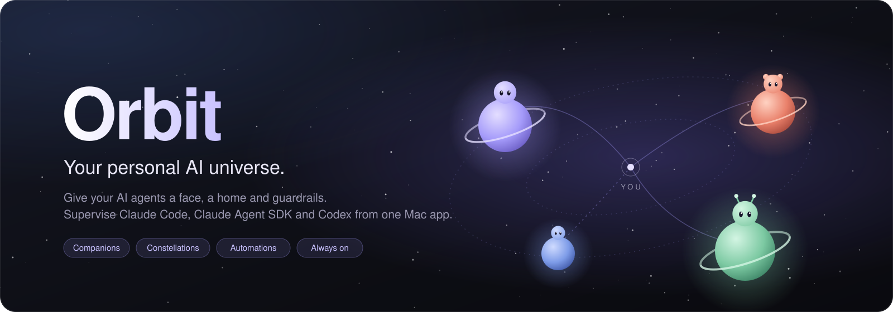
</p>

<p align="center">
  <b>A home for your AI agents.</b> Give them a face, hand them missions, watch them work together,<br>
  and stay in control of every file they touch, from one Mac app.
</p>

<p align="center">
  
  
  <a href="LICENSE"></a>
  
  
  
</p>

<p align="center">
  <a href="#quick-start">Quick start</a> ·
  <a href="#features">Features</a> ·
  <a href="#always-on">Always On</a> ·
  <a href="#security">Security</a> ·
  <a href="#documentation">Docs</a>
</p>

<br>

<p align="center">
  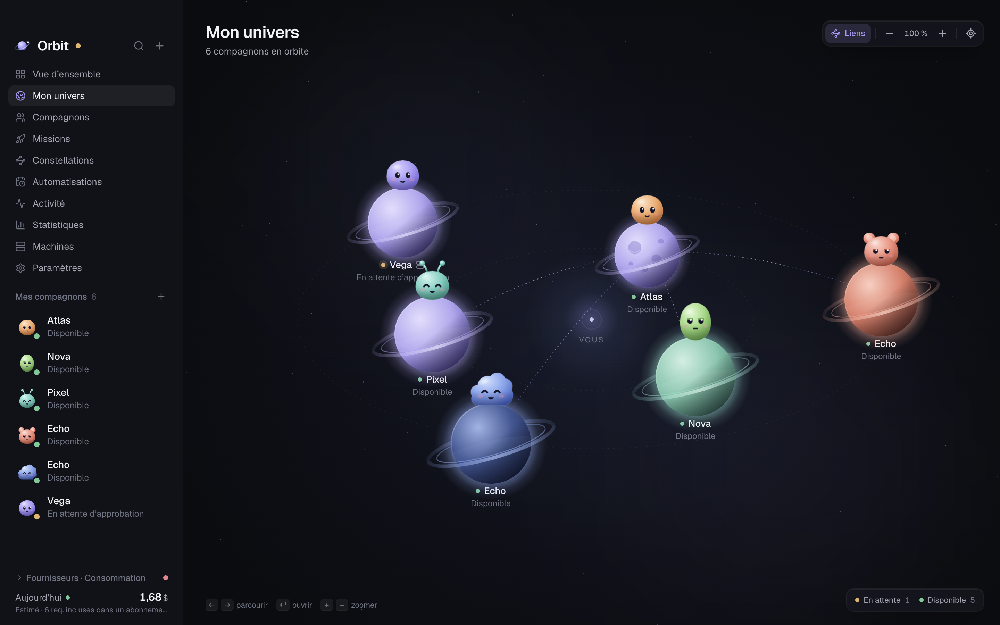
</p>

---

## Why Orbit?

AI agents are becoming coworkers, but they still live in terminal tabs, scattered dashboards and forgotten cron jobs. You never quite know who is doing what, how much it costs, or what they are allowed to touch.

**Orbit turns your agents into companions.** Each one gets a personality, an avatar planet, a folder it is allowed to work in, an engine and a budget. They live together in your own little universe, with you at its center.

- **See everything at a glance.** Who is busy, who is waiting for you, what it costs today.
- **Make them collaborate.** A coordinator splits a goal, delegates to specialists and writes the synthesis.
- **Let them work while you sleep.** Recurring missions, on your Mac or on your own Linux server.
- **Never lose control.** Routine work runs on its own; sensitive actions wait for your approval.

## Features

### Companions with a face

Create a companion with a name, a role, a look, an engine and a working folder. Orbit shows them as planets orbiting you, with live status: available, working, or waiting for your approval.

<p align="center">
  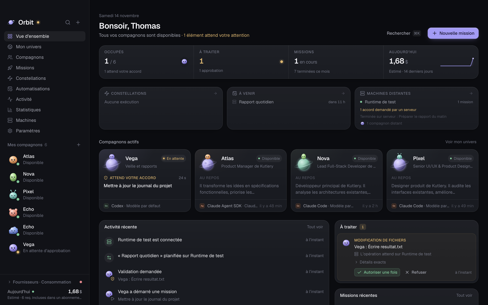
</p>

### Bring your own engine

Orbit doesn't reinvent the agent. It drives existing ones through their **official** authentication: no scraped sessions, no shared credentials.

| Engine | How it connects |
|---|---|
| **Claude Code** | Your local `claude` install and your own login. Orbit never reads your credentials. |
| **Claude Agent SDK** | The Anthropic API key you saved in Orbit (encrypted in the macOS Keychain). |
| **Codex** | `codex app-server` with your `codex login` (ChatGPT or API key). |
| **Chat** | Anthropic and OpenAI APIs with streaming, cancellation and official usage reporting. |

Engines can be mixed: a Claude Code developer and a Codex reviewer can sit on the same team.

### Constellations: agents that work as a team

Give a goal to a constellation and its coordinator plans the work, delegates sub-missions to the right companions, checks the results and writes a synthesis. Follow it live as a universe, a list or a timeline, approve the plan before it starts, and resume a run after a restart.

<p align="center">
  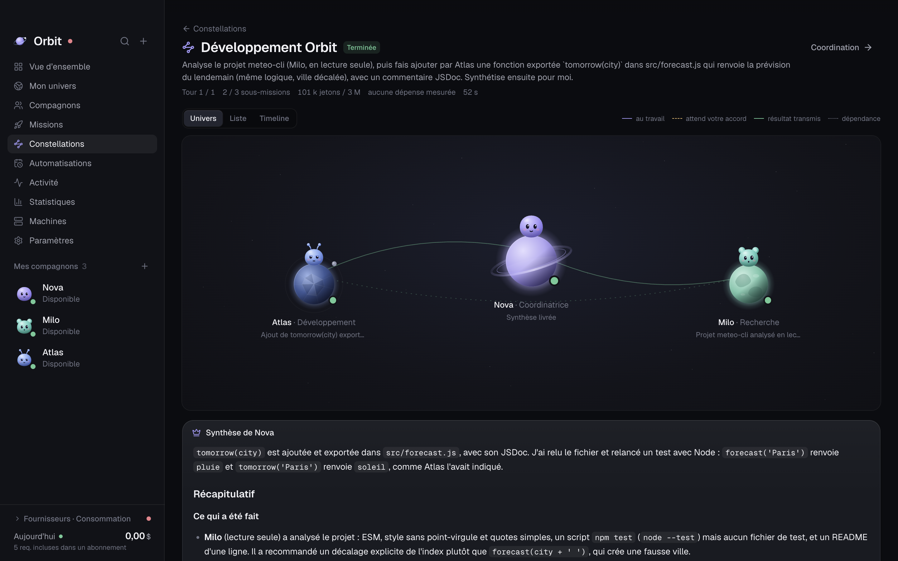
</p>

### Automations

Daily reports, weekly audits, triggered missions. Explicit time zones, controlled catch-up of missed runs, and a clear view of what is coming next.

### Know what it costs

Per-companion, per-engine and per-day usage, with a clear distinction between **official** costs reported by the provider and **estimates**. Budgets stop a mission before it runs away. Provider status (Anthropic, OpenAI) is monitored right from the sidebar.

| | |
|---|---|
| 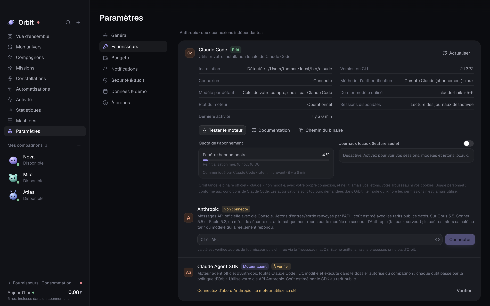 | 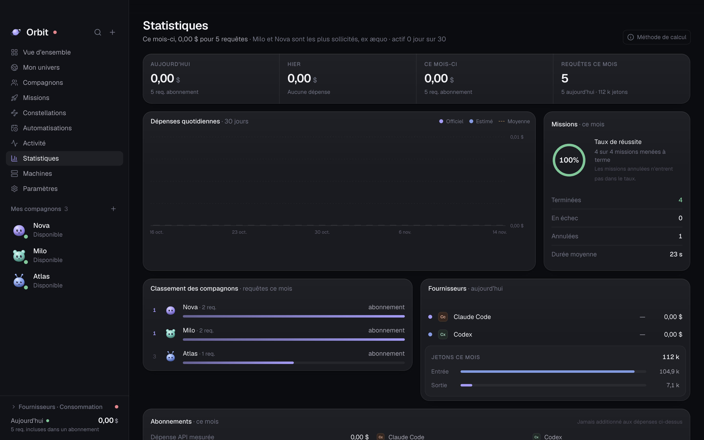 |
| 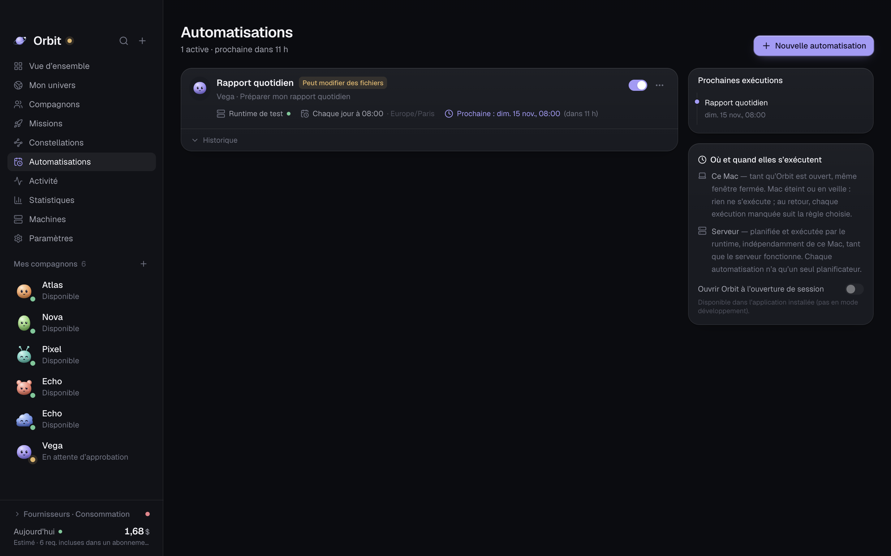 | 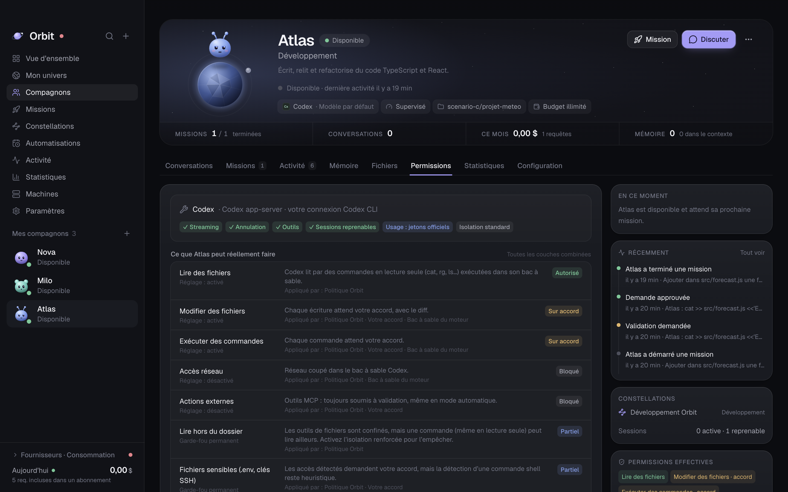 |

## Always On

Close your laptop and your companions keep going.

**Orbit Runtime** is a self-contained Linux service that runs **the same core** as the desktop app: missions, permissions, approvals, budgets, constellations and the scheduler. It ships as a single file (Node ≥ 22.16, no native modules) and installs under a dedicated user with a hardened systemd unit. No port is opened: Orbit connects over SSH with a key restricted to `attach`.

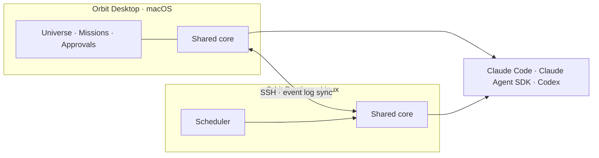

- **Sync** through a transactional event log: reconnecting resumes without gaps or duplicates.
- **Remote approvals** are single-use: approve from your Mac, the server proceeds.
- **One scheduler at a time**, with coordinated hand-offs between Mac and server.
- **Verified artifacts** come back to your Mac when a remote mission ends.

| | |
|---|---|
| 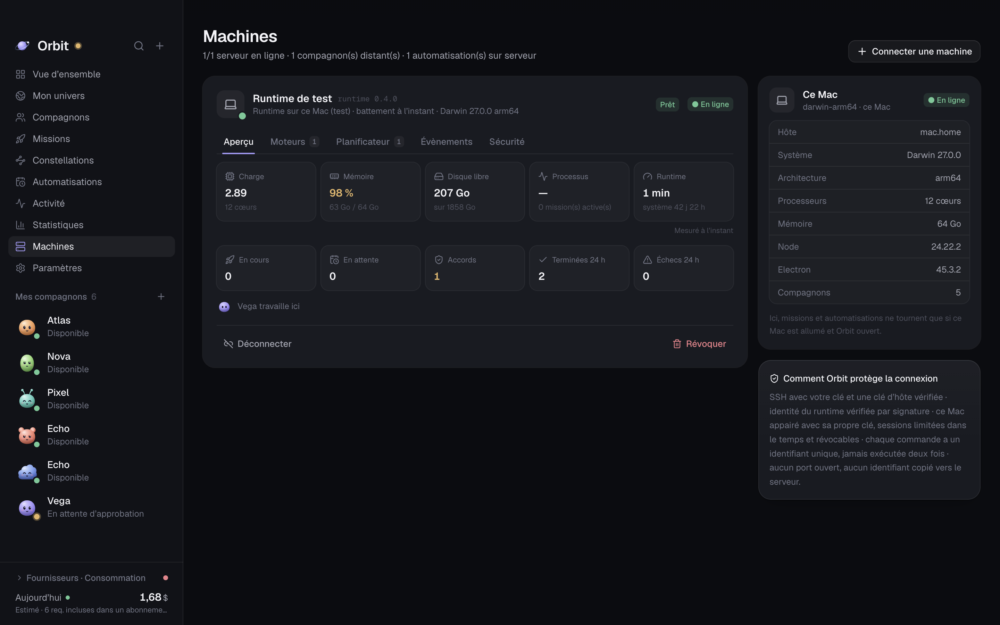 | 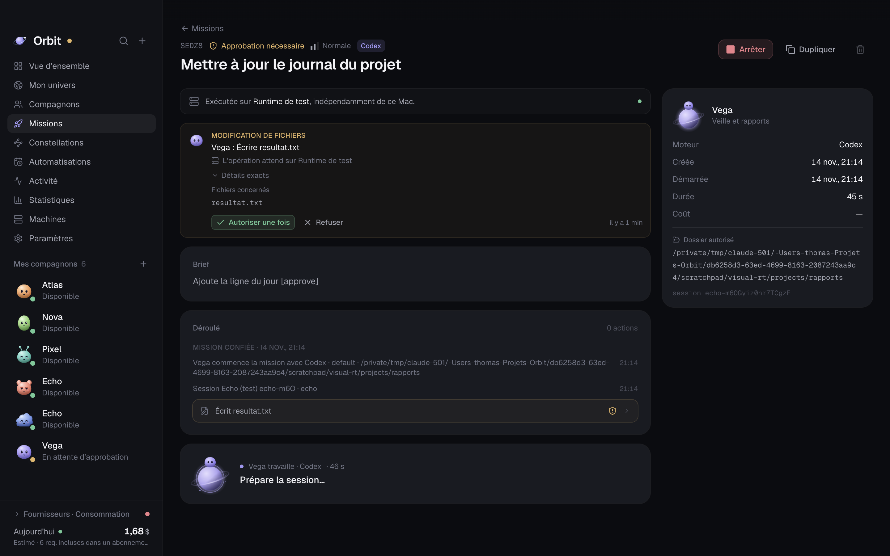 |

## Security

Agents with shell access need real guardrails. Orbit stacks three independent layers:

1. **Orbit's policy, always on.** Every tool call goes through a single gate that decides *allow / ask / deny*. Commands are analysed by their arguments and effects (`git status` is not `git push --force`, `npm test` is not `npm publish`), including through `sh -c`, pipes and `$(…)`.
2. **The engine's own sandbox.** Codex Seatbelt, Claude Code in restricted mode, Claude Agent SDK with limited tools.
3. **Hardened isolation (optional, per companion).** An Orbit Seatbelt profile wraps the whole process tree, enforced by the kernel and proven by a self-test.

Pick an autonomy level per companion (**Manual**, **Supervised**, **Automated** or **Autonomous**) and remember decisions *once*, *for this mission* or *always*. Sensitive files (`.env`, SSH keys, credentials) always require your approval. Everything is logged in a security audit trail.

Secrets are encrypted with Electron `safeStorage` (key in the macOS Keychain). The UI never sees a key, only that one exists.

## Quick start

> **Requirements:** macOS on Apple Silicon, Node.js and npm. For agent companions, install the engines you want: [Claude Code](https://docs.claude.com/en/docs/claude-code) and/or [Codex](https://github.com/openai/codex).

```bash
git clone https://github.com/BodaThomas/orbit.git
```

```bash
cd orbit && npm install
```

```bash
npm run dev
```

On first launch, onboarding lets you connect Anthropic or OpenAI (the key is verified, then encrypted in the Keychain), or explore **demo mode**: a separate database, no network requests, nothing to configure.

Then create a companion, choose an engine, give it a folder and send it on its first mission.

<details>
<summary><b>Build a standalone app</b></summary>

```bash
npm run package
```

Produces an unsigned `release/mac-arm64/Orbit.app`. `npm run dist` builds a `.dmg`.

</details>

<details>
<summary><b>Install Orbit Runtime on a Linux server</b></summary>

```bash
npm run build:runtime
```

This builds `out/runtime/orbit-runtime.mjs`. Follow [docs/REMOTE_SETUP.md](docs/REMOTE_SETUP.md) for the dedicated user, systemd unit and SSH key, and [docs/BACKUP_RESTORE.md](docs/BACKUP_RESTORE.md) for backups. Deployment files live in [`deploy/`](deploy/).

</details>

## Development

| Command | What it does |
|---|---|
| `npm run dev` | Electron + Vite with hot reload |
| `npm run build` | Builds main, preload, renderer and the runtime into `out/` |
| `npm run typecheck` | Strict TypeScript (main process and renderer) |
| `npm run lint` | ESLint |
| `npm test` | Vitest, run inside Electron's Node (same SQLite binary) |
| `ORBIT_TEST_DB=node npm test` | Whole suite on `node:sqlite` (the runtime driver) |
| `ORBIT_LIVE=1 npm test` | Adds network tests against the real APIs with an invalid key |
| `ORBIT_LIVE_CODEX=1 npm test -- engines.live` | A real Codex mission in a temp folder (uses your `codex login`) |
| `ORBIT_LIVE_CLAUDE_CODE=1 npm test -- claude-code.live` | A real Claude Code session in a temp folder |
| `sh deploy/validate-linux.sh` | Runtime validation in local Linux containers (Docker) |
| `npm run db:generate` | New Drizzle migration after a schema change |

**Data** lives in `~/Library/Application Support/Orbit/` (`orbit.db`, `orbit-demo.db`). Set `ORBIT_DATA_DIR` to use another folder. `ORBIT_CODEX_PATH` and `ORBIT_CLAUDE_PATH` point to alternative engine binaries.

**Stack:** Electron 45 · React 19 · TypeScript 5.9 · Tailwind 4 · Radix · Motion · Zustand · TanStack Query · SQLite (better-sqlite3 / `node:sqlite`) + Drizzle · Zod 4 · Vitest.

<details>
<summary><b>Visual capture (dev only)</b></summary>

After `npm run build`:

```bash
ORBIT_CAPTURE_STEPS='["wait:1500","nav:/universe","shot:universe"]' ORBIT_CAPTURE_DIR=./captures npx electron .
```

</details>

## Documentation

| Topic | |
|---|---|
| Engines (Claude Code, Agent SDK, Codex) | [docs/ENGINES.md](docs/ENGINES.md) |
| Constellations | [docs/CONSTELLATIONS.md](docs/CONSTELLATIONS.md) |
| Automations | [docs/AUTOMATIONS.md](docs/AUTOMATIONS.md) |
| Permissions & autonomy levels | [docs/PERMISSIONS.md](docs/PERMISSIONS.md) |
| Security model | [docs/SECURITY.md](docs/SECURITY.md) |
| Statistics & costs | [docs/STATS.md](docs/STATS.md) |
| Runtime architecture | [docs/RUNTIME_ARCHITECTURE.md](docs/RUNTIME_ARCHITECTURE.md) |
| Remote setup · Scheduler · Backups | [docs/REMOTE_SETUP.md](docs/REMOTE_SETUP.md) · [docs/SCHEDULER.md](docs/SCHEDULER.md) · [docs/BACKUP_RESTORE.md](docs/BACKUP_RESTORE.md) |
| Manual testing | [docs/MANUAL_TESTING.md](docs/MANUAL_TESTING.md) |
| Architecture & design decisions | [docs/ARCHITECTURE.md](docs/ARCHITECTURE.md) |
| Known limitations & open work | [ROADMAP.md](ROADMAP.md) |
| Contributing | [CONTRIBUTING.md](CONTRIBUTING.md) |
| Changelog | [CHANGELOG.md](CHANGELOG.md) |

The app UI is currently in French.

## Roadmap

- [x] Companions, chat and usage tracking (Anthropic, OpenAI)
- [x] Agent engines: Claude Code, Claude Agent SDK, Codex
- [x] Constellations with plan approval and resume
- [x] Automations and scheduler
- [x] Smart permissions and hardened isolation
- [x] Orbit Runtime for Linux, with sync and remote approvals
- [ ] More providers: Gemini, Grok, OpenRouter, Ollama
- [ ] Signed and notarized macOS builds
- [ ] English UI

Known limitations and open work are listed in [ROADMAP.md](ROADMAP.md).

## Contributing

Issues and pull requests are welcome. See [CONTRIBUTING.md](CONTRIBUTING.md). Before opening a PR, please run:

```bash
npm run typecheck && npm run lint && npm test
```

Contributions require agreeing to the short [Contributor License Agreement](CLA.md): you keep your copyright and grant the project the rights it needs to stay sustainable. The pull request template has a checkbox for it.

## License

Orbit is free and open source software, released under the [GNU Affero General Public License v3.0](LICENSE). Copyright © 2026 Thomas Boda.

You can use, study, modify and share Orbit. If you distribute a modified version, or run one as a network service, you must publish its source code under the same license.

The **Orbit name and logo** are not covered by the license. Forks are welcome under a different name and icon: see the [trademark policy](TRADEMARKS.md).

<br>

<p align="center">
  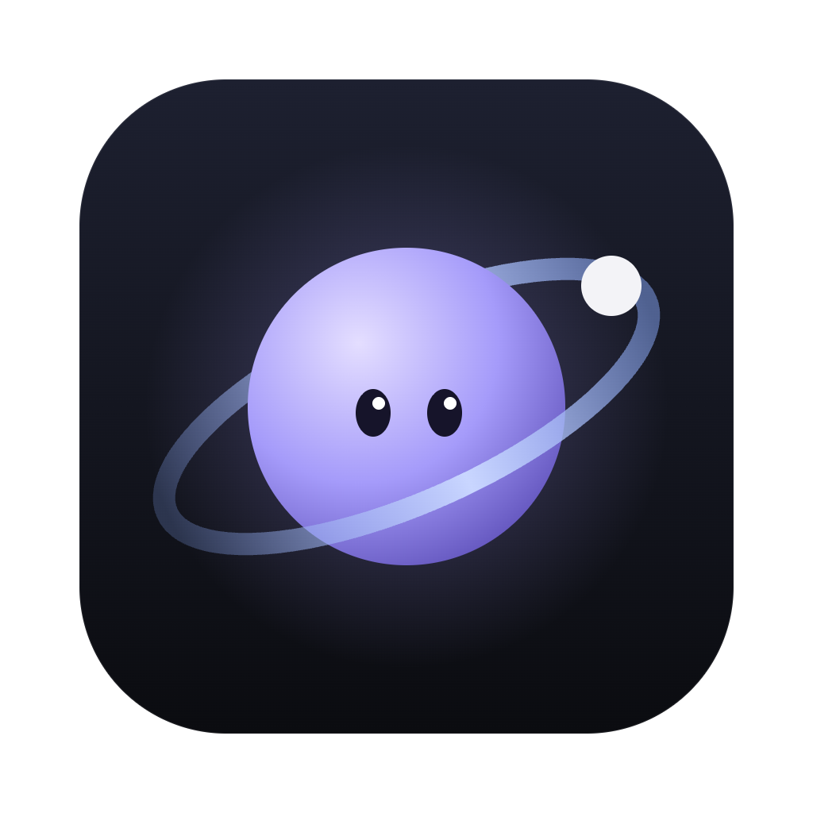<br>
  <sub>Made with care for people who work alongside AI.</sub>
</p>
